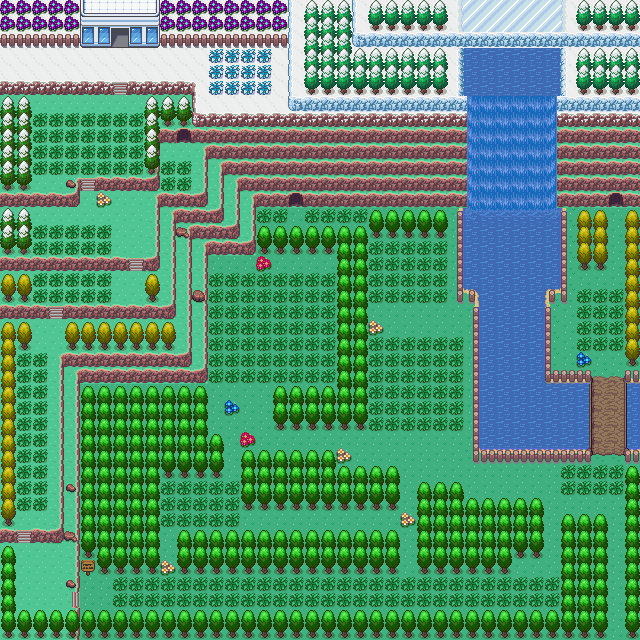
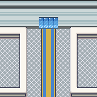
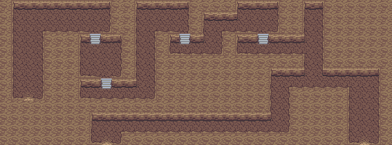
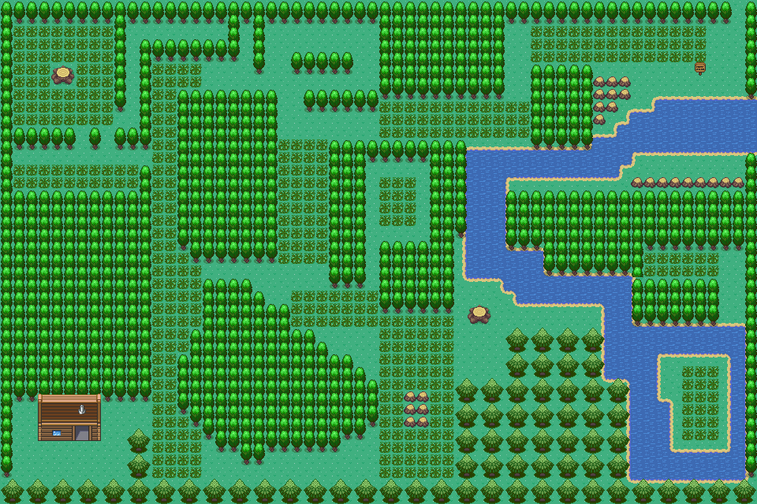

# Park

## Connections
### [Lion Mountain](lion-mountain.md) 

## Locations
Sign a:
- "Pepper Park: See exotic monsters and take them home!"

## Events

## Entrance

### Characters
**Magician** (gray hair) Elroy:
- "Welcome to Pepper Park. Entry is $500. You'll get 25 [Park Tuxeball](/items/park-tuxeball.md). Are you ready?"
(if enough money)
- "Enjoy your experience!"
- Player receives 25 [Park Tuxeball](/items/park-tuxeball.md)
(if not enough money)
- "Unfortunately you don't have enough money!"

**Florist** (fiery hair) Emily:
- "Welcome!"

## Cave

The cave will allow the player to reach 3 additional piece of grass.

### Characters
**Scientist**:
- "Many parks limit or even prohibit scientific activities, but we are at the forefront of ecological knowledge!"

## Park
The main zone where the park experience is played.

### Characters
**Magician** (fiery hair) Guardian:
- "Do you want to interrupt your experience?"
(if yes, the player gets teleported back to the entrance. It loses all the [Park Tuxeball](/items/park-tuxeball.md))

**Tennis Player**:
- "Fingers crossed your next encounter is with a friendly one!"

**Professor**:
- "There are fences for the visitors, but no fences around the park for the monsters, and that's the way a park is supposed to be."

**Soldier**:
- "I think the park has done a pretty good job of being everyone's friend."

## Park (South)

The secondary zone (south side).

### Old Cabin
An old cabin in the South zone.

## Alerts
(when 100 steps left)
- "You still have (variable_steps) steps left!"

## Encounters (Wild Monsters)
There are 15 zones (grass), technically each one could trigger different monsters.
- to_complete

## Mechanics
There are 4 options when bumping into a random wild monster:
- Ball (throw a [Park Tuxeball](/items/park-tuxeball.md))
- Doll (throw a doll, try to attract and facilitate capture)
- Food (throw food, try to attract and facilitate capture)
- Run (run away)

(stuff below -> I'm going to move somewhere else when completed)

### Base Catch Rate (BCR)
Base Catch Rate: range 0.01 - 0.99 (eg common 0.35, uncommon 0.2, rare 0.12, legendary 0.03).
### Level Factor (LF)
Level Factor > Linear Decrease: 1 - (MonsterLevel / MaxMonsterLevelInThePark)
### Item Bonus (Food)
- Food Effectiveness (FE): The base effectiveness of the food item.
Examples Food:
- Apple - 1.0 base effectiveness
- Golden Apple - 1.5 base effectiveness
- Dragon Meat - 1.8 base effectiveness
- Forbidden Juice - 2.5 base effectiveness
- Stardust Cookie - 2.0 base effectiveness
### Item Bonus (Dolls)
- Doll Effectiveness (DE): The base effectiveness of the doll item.
Examples Dolls:
- A Doll - 0.5 base effectiveness
- B Doll - 1.0 base effectiveness
- C Doll - 1.5 base effectiveness
- D Doll - 2.0 base effectiveness
- E Doll - 2.5 base effectiveness
### Time of Day Bonus (TDB)
- A multiplier based on the time of day. Dawn (0.95), Morning (1.0), Afternoon (1.05), Dusk (1.1), Night (0.9).
#### Time of Day + Condition
- Dawn: monsters sleep / confusion
- Morning: monsters / hungry
- Afternoon: monsters sluggish / thirsty
- Dusk: monsters cautious / irritable
- Night: monsters aggressive / fearful
### Seasonal Bonus (SB)
- A multiplier based on season of year. Winter (0.9), Spring (1.05), Summer (1.0), Autumn (0.95).
### Random Factor (RF)
- A random number between 0 and 1.
### Formula
 * catch_rate = (BCR * 0.01) * LF * (FE * DE) * RF * TDB * SB
