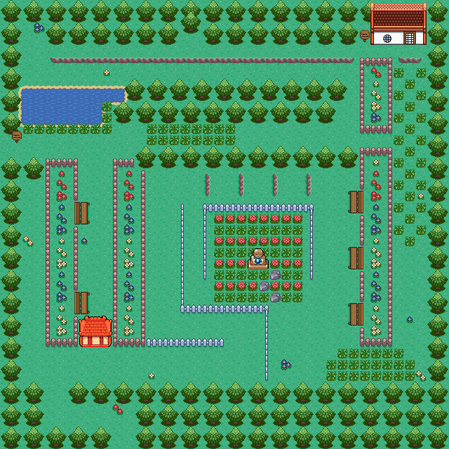

# City Park

## Connections
### A. [Route 2](route-2.md)
### B. [Leather Town](leather-town.md)

## Items

- a. [Tuxeball](/items/tuxeball.md)
- b. [Tuxeball](/items/tuxeball.md)
- c. [Restoration](/items/restoration.md)
- d. [Potion](/items/potion.md)
- e. [Potion](/items/potion.md)

### Characters

A and B: 

**Maniac**:
- Phew, we're pooped! 

**Granny**:
- We'll walk back to [Leather Town](leather-town.md) after a little rest.

C. **Florist**:

- Enjoy the flower display! It's the pride of [Leather Town](leather-town.md). 

D. **Florist**:
- The flowers look okay, don't they? ... Ever since the mining began in [Leather Town](leather-town.md), the flowers have been under the weather!

### Trainers
E. **Florist** Frances
- I have the finest gardens in all the land. That's why these Shybulb keep turning up.
- [Shybulb](/monsters/shybulb.md) level 8, [Shybulb](/monsters/shybulb.md) level 8
- You must come and visit some time. 

''(Disappears by the time the player has made it to Route 6, as Frances appears again then.)''

F. **Cat Girl** Bobette
- I love cats. An Aardorn is basically a cat, right?
- [Aardorn](/monsters/aardorn.md) level 10
- A cat would have won ...

G. **Picnicker** Edith
- Hey, did you say I'm like my tuxemon? I'll fight you for that!
- [Squabbit](/monsters/squabbit.md) level 8, [Squabbit](/monsters/squabbit.md) level 8
- Hmm, you may have a point.

### Encounters
- [Cardiling](/monsters/cardiling.md)
- [Cardiwing](/monsters/cardiwing.md)
- [Cataspike](/monsters/cataspike.md)
- [Puparmor](/monsters/puparmor.md)
- [Eyenemy](/monsters/eyenemy.md)
- [Axolightl](/monsters/axolightl.md)
- [Squabbit](/monsters/squabbit.md) (first appearance)
- [Tourbidi](/monsters/tourbidi.md) (first appearance)

### Fishing/Surfing
- [Fluoresfin](/monsters/fluoresfin.md)
- [Sheye](/monsters/sheye.md)
- [Nudiflot M](/monsters/nudiflot-m.md)
- [Nudiflot F](/monsters/nudiflot-f.md)

### Locations
#### Achievement Maniac's House

''(When first spoken to)''

- I'm the Achievement Maniac! I'm young. ... Well, at heart. My body is old and frail. All my life, my dream has been to do the things that no one else has done. Like ... giving a dog tuxemon to a **Cat Girl**. I wrote down all the things I wanted to do in my [Book of Wishes](/items/book-of-wishes.md). But it's unfinished ...
- Do you want to help me? You can do all the challenges that I didn't get around to! (Y/N)

''(When next spoken to)''

- How are you getting along with the [Book of Wishes](/items/book-of-wishes.md)? Tell me of your achievements ... 

''(If there have been achievements)''

- You've achieved X?/You've achieved X and Y?/You've achieved X, Y and Z? Fantastic! Let me give you a little memento of your achievement.

''(Otherwise)''

- Huh, nothing new. Well, keep working on it!
