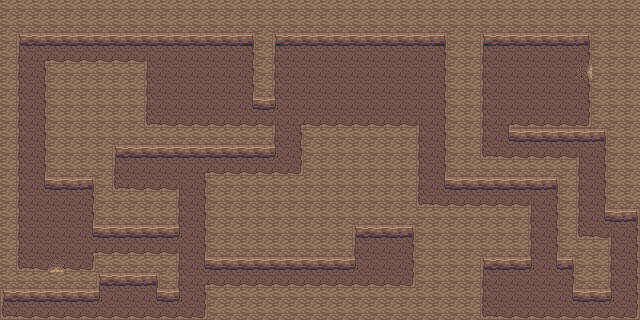

# Cotton Tunnel

## Connections
### [Dragon's Cave](dragon's-cave.md)
### [Cotton Town](cotton-town.md)

## Items
- [Candy Tuxeball](/items/candy-tuxeball.md)
- [Petrified Dung](/items/petrified-dung.md)
- [Imperial Potion](/items/imperial-potion.md)
- [Imperial Tea](/items/imperial-tea.md)
- [Cureall](/items/cureall.md)
- [Raise Melee](/items/raise-melee.md)

## Events
### Event Benden
When the player enters the Cotton Tunnel from the [Dragon's Cave](dragon's-cave.md).

**Dragonrider** Benden:
- It... escaped! Drokoro is free! Perhaps... Perhaps it'll find a place where it can grow strong, where it can truly be itself. There is still hope. (if the player doesn't capture [Drokoro](/monsters/drokoro.md))
- You... You captured it. Know this, though: the path to becoming a true Dragonrider has begun. You'll face many challenges, many trials. But if you're worthy, you'll find your own path to balance, your own way to protect this land. (if the player captures [Drokoro](/monsters/drokoro.md))
then, no matter the result
- We, the Dragonriders, will retreat to Lion Mountain. There, we'll watch over this land from afar, hoping that the balance can somehow be restored.

## NPCs

**Enforcer** Angry Brute:
- The bosses get to go in and have all the fun.

**Enforcer** Concerned Brute:
- Wait, if we're all here - who's guarding Omnichannel HQ?

**Enforcer** Lazy Brute:
- I'm exhausted after all that tunnelling.

**Professor**: 
(Down a dead end somewhere)

- Drat this infernal maze of tunnels. ... 
- Oh, hello child. ... 
- Me, lost? ... 
- Not at all. I know exactly where I am. 

**Shop Assistant**: 
(Down a different dead end)
- I hope the professor is okay. He said he saw a fossil and ran off! 

**Dragonrider** Carlos:
- I fell down a crack in the Dragon's Cave and wound up here somehow. Show me out of here, peasant! 
- [Agnidon](/monsters/agnidon.md) level 35, [Legko](/monsters/legko.md) level 35
- Hmm, perhaps I could have phrased that more nicely.

## Encounters

- Dinoflop (levels 35-40)
- Metesaur (levels 30-35)
- Furnursus (levels 30-35)
- Boltnu (levels 25-35)
