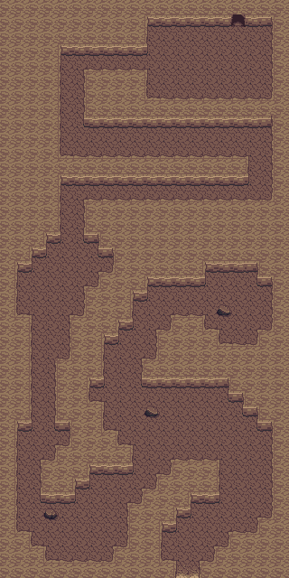

# Dragon's Cave

## Connections
### [Sea Route C](sea-route-c.md)
### [Cotton Tunnel](cotton-tunnel.md)

## Encounters
- [Agnite](/monsters/agnite.md) (first appearance)
- [Agnigon](/monsters/agnigon.md) (first appearance)
- [Embra](/monsters/embra.md) (first appearance)
- [Ruption](/monsters/ruption.md) (first appearance)

## Events
### 1. Spyder Plot
''After the Protagonist defeats Dragonrider Benden, animation of the two characters entering the final room. Spyder is already there, with Enforcers and the Extreme Restraints.''

**Dragonrider** Benden
- What is this? These villains are trying to steal Drokoro! But why?

**Spyder Agent** Mallory
- The Drokoro is ours! We got Shaft to dig it up from beneath Route 3, and we would have kept it if that infuriating kid hadn't interrupted our plans. It is time for the Pillars to combine their strength and rule this region outright! Too long have we let the Cathedral and the public tell us what can and cannot be done with Tuxemon. When we use Greenwash's fusion technology to combine this Drokoro with the killer robots built by Nimrod, we will be unstoppable! And the best part is, Omnichannel will tell the public that this is all in their best interests - and the public will believe them!

**Dragonrider** Benden
- Please, NAME. If you can't stop these villains, all is lost.

## Items

2. [Escape Key](/items/escape-key.md)

3. [Boost Armour](/items/boost-armor.md)

4. [Boost Melee](/items/boost-melee.md)

5. [Super Potion](/items/super-potion.md)

## Characters
A. **Dragonrider** Tomas
- Once we each rode a dragon. That was long ago. But just recently a new-born dragon appeared above this island, and crawled into this cave. 
- [Allagon](/monsters/allagon.md) level 35
- As you can see, the age of the dragons has passed. The hatchling dragon is our last hope. 

B. **Dragonrider** Lessa
- We stand guard over this, the last dragon. We don't know where it came from or why it hatched. We thought all dragons had hatched long ago.  
- [Ferricran](/monsters/ferricran.md) level 37
- Maybe someone will come who has the power to defeat it.

C. **Dragonrider** Cailin
- This is our last duty. Dragarbor is so very tired.
- [Dragarbor](/monsters/dragarbor.md) level 36
- Thank you.

D. **Dragonrider** Griffin
- I wonder what it would be like to be swallowed by a dragon ...
- [Bigfin](/monsters/bigfin.md) level 35
- Oh well - pobody's nerfect!

E. **Dragonrider** Daenny
- Prepare to be defeated!
- [Eaglace](/monsters/eaglace.md) level 37
- You may have bested me, but you'll never best Benden. 

F. **Dragonrider** Benden
- I am the last and most powerful of the dragonriders.
- [Dragarbor](/monsters/dragarbor.md) level 36, [Sapragon](/monsters/sapragon.md) level 38
- You have defeated me. You deserve to face Drokoro. Let me heal you - then, good luck.
- Triggers Event A

### Final Room
G. **Spyder Agent** Mal
- You have gotten in our way too many times! 
- [Djinnbo](/monsters/djinnbo.md) level 40
- Ah ha, you fell right into my trap!

H. **Spyder Agent** Ray
- All we want to do is create a mega-corporation that takes over the government. Is that so wrong?
- [Ghosteeth](/monsters/ghosteeth.md) level 40
- You're taking away my freedoms. 

I. **Enforcer** Lucille
- The Pillars are the only way we'll get anything done around here. 
- [Coleorus](/monsters/coleorus.md) level 40
- You'll regret this. 

J. [Nimrod Boss Tru](../npcs/tru.md)
- This is for your own good, okay?
- [Embazook](/monsters/embazook.md) level 40, [Arthrobolt](/monsters/arthrobolt.md) level 40, [Hydrone](/monsters/hydrone.md) level 40
- Whatever. You'll never stop them back at Omnichannel HQ. 

K. [Drokoro](/monsters/drokoro.md), unique tuxemon
- Raawr!
- Level 45
