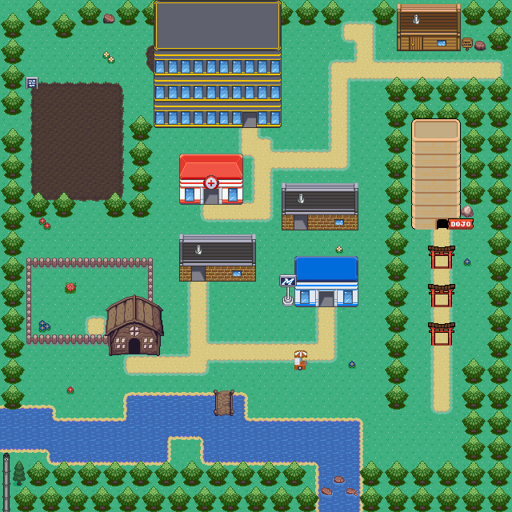

# Flower City

## Connections
### [Route 4](route-4.md)
### [Route 5](route-5.md)
After Event 1.
### [Side Route A](side-route-a.md)
### Riverboat Station
After [Timber Town](timber-town.md).
### [Side Route D](side-route-d.md)
### [Dojo of the Elements](dojo-of-the-elements.md)

## Encounters
### Fishing/Surfing
- [Rhinocarpe](/monsters/rhinocarpe.md)
- [Urcheedle](/monsters/urcheedle.md)
- [Drashimi](/monsters/drashimi.md)

## Locations
### [Nimrod HQ](nimrod-hq.md)
An **Enforcer** blocks the way to [Nimrod HQ](nimrod-hq.md) until the player defeats the [Dojo of the Elements](dojo-of-the-elements.md).

### Outdoors
**Cat Girl** Mieke
- It's exciting for us to visit the country of X! You have such unique tuxemon here ... Hey, do you want to trade? My [Conileaf](/monsters/conileaf.md) for a creature that we don't have back home ... how about [Budaye](/monsters/budaye.md)? Y/N

**Beachcomber** Fez
- Everyone in our region has to pick from one of the same five boring tuxemon. I know like a hundred people with a [Foxfire](/monsters/foxfire.md) ... Hey, do you want to trade? My [Foxfire](/monsters/foxfire.md) for an [Ignibus](/monsters/ignibus.md)? Y/N

**Snugglepot** Cady
- Oh I'd just love to have a souvenier to take back home with me. I just adore those sweet little [Grintot](/monsters/grintot.md). Could you get me one? I could give you my [Hampotamos](/monsters/hampotamos.md) in exchange? Y/N

**Picnicker** Teach
- Oh where has my other student gotten to?

**Child Actor** Sandy
- This [Pharfan](/monsters/pharfan.md) keeps spraying me with water. What a drag! Hey, do you want it? You'd have to give me a [Tweesher](/monsters/tweesher.md) in return. Y/N

**Fisher**
If player has [Fishing Rod](/items/fishing-rod.md):
- It's a slow pleasure, but there's nothing nicer than fishing by the water. 
- Just select your Rod from the Bag while facing the river.

If player does not:
- Get yourself a Fishing Rod so you can enjoy the water as I do.

### Pet Shop
**Shop Assistant**
- Hello and welcome to the Pet Shop! Are you interested in buying a tuxemon?
(if the player has $500)
- Each for $500

- [Ziggurat](/monsters/ziggurat.md) (level 10)
- [Woodoor](/monsters/woodoor.md) (level 10)
- [Fuzzlet](/monsters/fuzzlet.md) (level 10)
- [Potturmeist](/monsters/potturmeist.md) (level 10)
- [Squink](/monsters/squink.md) (level 10)

**Shopkeeper**
- ''(First time spoken to)'' I found these eggs in the bough of a tree, and hatched them! They appear to be a previously unknown tuxemon. I call them [Vivipere](/monsters/vivipere.md)! I wonder what they morph into. 
- ''(Then, and in the future if refused the first time)'' Tell you what, why don't I give you one and you can come back and tell me what it morphs into! Y/N

''(If the player returns having morphed it)''
- ... You got it to morph? ... And you did it in that particular way? ... I see ... Hmmm, I don't really like the look of that morph. If I give you another [Vivipere](/monsters/vivipere.md), can you bring it back if it ever morphs into something different? Y/N

''(This continues for as long as there are [Vivipere](/monsters/vivipere.md) morphs yet to be found.)''

[Conileaf](/monsters/conileaf.md) and [Rockitten](/monsters/rockitten.md) wander around outside. 

### House 1
**TV**
- Two mons are having a fight. "I'm not your friend, Budaye", one says.

**Firefighter**
- The five Pillars are the only big companies in this region. They have a lot of sway.

**Granny**
- Scoop has managed to cut the price of beef yet again! I don't know how they do it.

### House 2
**Soldier**
- I worked for Nimrod during the war. Not that I got a medal. Or a parade. They don't hand those out to mercenaries.

**Scientist**
- [Radio FUD](../radios/radio-fud.md) wakes me up every morning. Not sure I care for their politics, but at least they call it how they see it!

### Scoop Store
**Shopkeeper**
- Yesterday night, something incredible happened.\n I'm still trying to process it all. Would you like to hear about it? (Y/N)
if yes [Flashback](../flashbacks/o-captain-my-captain.md)

Stock:
- [Repellent](/items/repellent.md) — $100
- [Super Potion](/items/super-potion.md) — $300
- [Lavish Tuxeball](/items/lavish-tuxeball.md) — $300
- [Diurnal Tuxeball](/items/diurnal-tuxeball.md) — $300 (daytime only)
- [Nocturnal Tuxeball](/items/nocturnal-tuxeball.md) — $300 (night only)
- [Restoration](/items/restoration.md) — $400
- [Majestic Tuxeball](/items/majestic-tuxeball.md) — $600
- [Escape Key](/items/escape-key.md) — $600
- [Revive](/items/revive.md) — $1,000
- [Cureall](/items/cureall.md) — $1,500

Tech counter:
- [Flintstone](/items/flintstone.md) — $2,000
- [Thunderstone](/items/thunderstone.md) — $2,000
- [Grintot](/monsters/grintot.md) — $4,000 (level 10)

### Dojo of the Elements

[Dojo of the Elements](dojo-of-the-elements.md)
