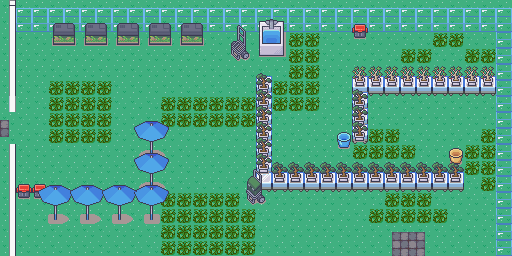
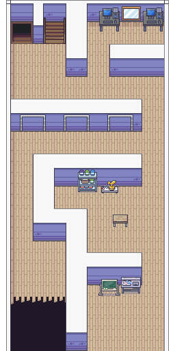
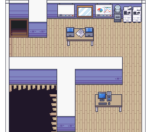

# Greenwash HQ

**Greenwash HQ** is in [Candy Town](candy-town.md).

When you leave, the blockade of [Route 6](Route 6.md) ends, because "We've gathered all the remaining lab tuxemon and either released them into the wild or taken them as pets. There's nothing that the ENFORCERS can do!"

# Greenhouse

## Characters

### **Scientist** Gregor

- I spend all day watching my CATEYE - I'm going to catch it blinking!
- [Cateye](/monsters/cateye.md) level 24
- Ugh, it didn't even blink when it fainted!

### **Scientist** Louis

- The rules of this battle are the simple laws of natural selection: only the strong survive!
- [Cateye](/monsters/cateye.md) level 24
- May I introduce you to the Gaia Hypothesis?

### **Firefighter** Lewis

- Hey, this is an active emergency. Get out of here!
- [Pharfan](/monsters/pharfan.md) level 24
- Great, now I've got nothing to fight the fires with.

### **Firefighter** (no battle)

I could battle you, but I prefer to appeal to your reason and common sense. If you don't get out of here, the building might fall on you!

### **Scientist** Hunt

- Come work at Greenwash, they said. Perform experiments that blur the line between science and madness, they said. Look where that got me!
- [Cateye](/monsters/cateye.md) level 25, [Propellercat](/monsters/propellercat.md) level 25
- There's no future in STEM, kid.

### **Florist** Alex

- I order all my flowers from Greenwash. They have varieties that I've never seen before!
- [Shybulb](/monsters/shybulb.md) level 25
- Here's my card in case you ever need a flower arrangement. I do weddings, funerals, birthdays ...

### **Florist** Gluck

- Say what you will about genetic engineering, hydroponics and chemical fertilizers, but you can't argue with the results.
- [Narcileaf](/monsters/narcileaf.md) level 25
- That settles it, I'm giving Narcileaf another dose of fertilizer when we get home.

## Encounters

- [Cochini](/monsters/cochini.md) (first appearance)
- [Cateye](/monsters/cateye.md) (first appearance)
- [Sclairus](/monsters/sclairus.md) (first appearance)
- [Bursa](/monsters/bursa.md) (first appearance)
- [Nut](/monsters/nut.md) (first appearance)

# Ground Floor

## Characters

### **Scientist** Chip

- I have developed unmatched computing power!
- [Pigabyte](/monsters/pigabyte.md) level 25, [Cochini](/monsters/cochini.md) level 23
- Needs more power!

### **Aviator**Clarence

- My tuxemon are unstoppable in the sunlight!
- [AV8R](/monsters/av8r.md) level 22, [Criniotherme](/monsters/criniotherme.md) level 22, [Tikorch](/monsters/tikorch.md) level 22
- ... Almost unstoppable.

### **Firefighter** Lewie

- Just some broken glass and escaped monsters. I was hoping for a fire.
- [Agnite](/monsters/agnite.md) level 26
- I like fire a normal amount.

### **Scientist** Morehouse

- They said to get out, but I'm not leaving without my notebook of scientific observations.
- [Eyenemy](/monsters/eyenemy.md) level 20, [Eyesore](/monsters/eyesore.md) level 20
- I'm sure my notebook is around here somewhere.

### **Nurse** Broer

- Every day, I sedate all the monsters so they can be observed safely. I forget ONE TIME, and everyone makes a huge fuss.
- [Coleorus](/monsters/coleorus.md) level 26
- Whatever. Here, have a potion. (Player receives a [Potion](/items/potion.md))

## Boss' Office

*(Only accessible by falling from a higher level)*

### [Greenwash Boss Looten](../npcs/looten.md)

- Prepare to face the power of my fusion tuxemon!
- [Bearloch](/monsters/bearloch.md) level 30, [Rocktot](/monsters/rocktot.md) level 30, [Foxko](/monsters/foxko.md) level 30, [Agnsher](/monsters/agnsher.md) level 30
- Well, I guess fusion technology isn't quite there yet. We've been working on it for years!
- Here's the closest we've come -- it's a cute fusion of an ant and an Aardorn. Not exactly the ultimate killing machine Omnichannel wanted us to create. I mean … uh! You didn't hear that from me.
- The funny thing is, because of its fusion DNA, it makes DNA screeners behave all funny.
- (Gives player [Aardant](/items/aardant.md))

# 1st Floor

## Characters

### **Nurse** Aissa

- Stay out - Greenwash has this all under control.
- [Cateye](/monsters/cateye.md) level 22
- We're all going to die!

### **Scientist** Moreau

- You shouldn't be here!
- [Sclairus](/monsters/sclairus.md) level 26
- The fusion experiment blew up!

### **Scientist** Dippel

- Maybe we went too far …
- [Criniotherme](/monsters/criniotherme.md) level 22, [Tikorch](/monsters/tikorch.md) level 22
- Or not far enough!

### **Rogue** Dempsey

- This is fine.
- [Masknake](/monsters/masknake.md) level 25
- This is fine.

### **Postboy** Heidenstam

- This has been one heck of a work experience placement.
- [Foofle](/monsters/foofle.md) level 10
- Gee, thanks a bunch.

### **Scientist** (The Fossilisator)

*(Standing next to the table that has a strange golden statue on it)*

- (first time) Hello there, I suppose you are here to see my finest invention - the De-Fossilator. ... No? You're here to investigate why the Greenwash staff went on strike and got locked out by the Enforcers?
- (first time and all times afterwards) While you're here you might as well see the De-Fossilator in action.
- (If they have a [Rhincus Fossil](/items/rhincus-fossil.md)): Ah, I see you have a toothed bird fossil. Shall I de-fossilate it? Y/N
- If yes: "It worked! The fossil turned into a Rhincus" (player gains a [Rhincus](/monsters/rhincus.md))
- (If they have a [Shammer Fossil](/items/shammer-fossil.md)): Ah, I see you have an ancient dog fossil. Shall I de-fossilate it? Y/N
- If yes: "It worked! The fossil turned into a Shammer" (player gains a [Shammer](/monsters/shammer.md))
- (If they have a [Rhincus Fossil](/items/rhincus-fossil.md) and a [Shammer Fossil](/items/shammer-fossil.md)): Ah, I see you have two ancient fossils. Shall I de-fossilate both? Y/N
- If yes: "It worked! The fossils turned into a Shammer and a Rhincus" (player gains a [Rhincus](/monsters/rhincus.md) and a [Shammer](/monsters/shammer.md))
- If the player says no to the fossil, or has no fossils: "Maybe another time then."

## PCs

### PC1

- Found a recorded conversation on PC. Play back? (Y/N)
- If yes: [Flashback](../flashbacks/jurassic-ethics.md)

### PC2

- Found a recorded conversation on PC. Play back? (Y/N)
- If yes: [Flashback](../flashbacks/frankenstein-playground.md)

## Items

*(Could be placed anywhere on the floor)*

- [Budaye](/monsters/budaye.md) in device
- [Masknake](/monsters/masknake.md) in device

## Expansion

If Fusion is implemented, the [Fusion Report](/items/fusion-report.md) will be provided instead of [Aardant](/items/aardant.md).

# 2nd Floor

## Emails & Notes

### PC1: Dempsey to Looten

- "I've been reviewing the latest data from the fusion experiment and I have to say, I'm getting a bit worried. The creatures we're creating are not what I expected. They're... unstable."

### PC2: Looten to Greenwash Staff

- "As you are all aware, we are on the cusp of a major breakthrough with the fusion experiment. I want to assure you that everything is under control and we are making great progress. As you know, our previous test did not yield the results we had hoped for. We have learned from that experience and are preparing for a new test. It will incorporate the knowledge and insights we gained from the previous failure. We have made significant adjustments to the experiment's parameters and are confident that this new test will be a success. I want to assure you that we are taking all necessary precautions to ensure the safety of our staff and the success of the experiment. Please disregard any rumors or concerns you may have heard. Keep up the good work, and let's make this next test a success!"

### PC3: Selby to Looten

- "I've been thinking a lot about the De-Fossilator and I have to admit, I'm getting a bit uneasy about the whole thing."

### Notes: Note from Dempsey

- "Fusion experiment risks: unstable creatures, environmental damage, human casualties. Must convince Looten to shut down experiment."
