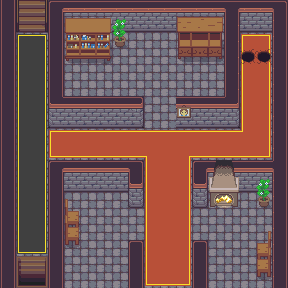
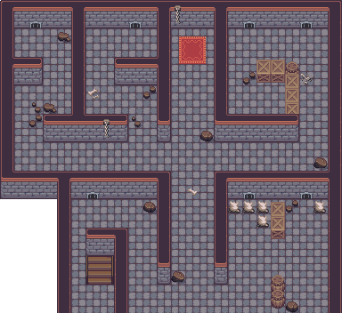
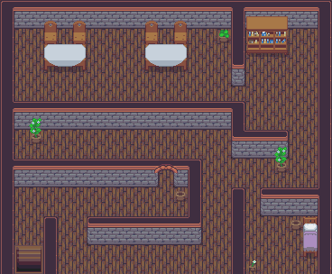

# Mansion

## Connections
### [Side Route A](side-route-a.md)

A mansion that [Team Bazaar](../factions/team-bazaar.md) is using (there's no Team Bazaar presence in [Flower City](flower-city.md), so if the trainers on this route wear you out, you'll have to pay for healing in Flower City from [Nimrod](nimrod-hq.md)).

This mansion, built by the wealthy Old Man Jenkins, has been abandoned for years, but it is said to still hold secrets. Legend has it that Jenkins made his fortune in some unknown venture before losing it all, leading to the mansion's decline.

They also install the [Renaming App](Renaming App.md) on your phone.

Can go into the basement for a dungeon, or up the stairs for a trainers-in-rooms-on-different-floors experience.

## Characters

### **Magician** (near the entrance)

- Welcome to the Bazaar Mansion. Please look past the mildew and creaky staircases; we've only just moved in.

### Portrait painting on the wall

- The eyes seem to follow you around the room.

### **Picnicker**

- In Team Bazaar, we love to hang out in out-of-the-way places so Omnichannel can't spy on us.

### **Magician** Gillette

- Ah-ha, finally - a worthy adversary.
- [Djinnbo](/monsters/djinnbo.md) level 22, [Ghosteeth](/monsters/ghosteeth.md) level 22
- I've gotten rusty.

### **Barmaid** Lucy

- Have you ever tried drinking Imperial Tea? Well, I did - and I learned so much!
- [Elofly](/monsters/elofly.md) level 15, [Budaye](/monsters/budaye.md) level 15
- Maybe I should have shared the tea with my tuxemon.

If you speak to her again:

- Hey, give this a try! (Player receives [Mystery Tea](/items/mystery-tea.md))

### **Barmaid**

- We're going to claim squatters' rights on this mansion. Just another thirteen and a half years to go!

### **Magician**

- Whoever owns this mansion seems to have forgotten about it. Can you imagine owning so many homes you forget about one?

### **Pirate** Lyle

- Arrr, hand over ye money and ye tuxeballs.
- [Foofle](/monsters/foofle.md) level 20, [Shybulb](/monsters/shybulb.md) level 20
- Don't be alarmed! I'm not a real pirate, just a fan of piracy.

### **Warrior** (block the corridor to the stairs until the **Riverboat Captain** is rescued)

- I wonder where our drinking buddy has gotten to?

### **Warrior** (block the corridor to the stairs until the **Riverboat Captain** is rescued)

- We started singing an old sea shanty, and by the time we'd done the Captain was missing!

# Mansion: Basement

## Items

- [Potion](/items/potion.md)
- TM [Ubuntu](/techniques/ubuntu.md)
- TM [Ice Shield](/techniques/ice-shield.md)
- [Tea](/items/tea.md)

## Characters

### **Baller**

- Brrr, it's cold down here.

### **Dancer** Coralli

- I've always loved the thrill of a tuxemon battle.
- [Tumbleworm](/monsters/tumbleworm.md) level 22, [Elofly](/monsters/elofly.md) level 22
- The comedown from an intense battle is hard.

### **Postboy** Bobby

- Do you like tuxemon? I've been obsessed since I was just eight years old.
- [Capiti](/monsters/capiti.md) level 26
- Yep, I've been obsessed with tuxemon for one year.

### **Healer** Catholi

- The scalpel can cut to save a life or to end it.
- [Foofle](/monsters/foofle.md) level 20, [Rosarin](/monsters/rosarin.md) level 24
- There you go, no need to be scared.

### **Healer** Josephine (is standing next to Catholi)

- Never mind my bellicose friend. Do you want me to heal your team? Y/N
- *(If select yes, usable once only, then:)*
- I hope the healing helped.

### **Tennis Player** Roger

- Hello. I am a human child.
- [Polyrock](/monsters/polyrock.md) level 22
- *(Is gone when battle ends. Or, if that's not possible:)* Drat, I still have a lot to learn!

### **Rogue**

- They really should patch up that hole in the floor.

### **Riverboat Captain** (after the player next leaves the basement, he disappears, and is able to act as the Riverboat Captain taking the player up and down the river)

- Ahoy there! Thank you for finding me!
- I wandered off during last night's drinking session and fell down here.
- Hey, can you find the exit? Just shout out when you do.

## Encounters

- [Cairfrey](/monsters/cairfrey.md) (first appearance)
- [Polyrock](/monsters/polyrock.md) (first appearance)
- [Djinnbo](/monsters/djinnbo.md) (first appearance)
- [Pigabyte](/monsters/pigabyte.md) (first appearance)

# Mansion: Top

## Characters

### **Dancer**

- My parents think I'm paranoid, but I just don't trust Omnichannel. Or Scoop. Or Shaft. Or Greenwash. Or Nimrod, for that matter.

### **Barmaid**

- The big corporations sell monsters that can only be morphed using their own proprietary technologies!

### **Mage** Russell

- Have you heard of Botbot? It's the most versatile tuxemon.
- [AV8R](/monsters/av8r.md) level 22, [MRmOswitch](/monsters/mrmoswitch.md) level 22, [K9](/monsters/k9.md) level 22
- Just because it is versatile, does not mean it is powerful.

### **Rogue** Jackson

- Tuxemon are what you make of them. Weak trainers raise weak tuxemon.
- [Viviteel](/monsters/viviteel.md) level 26
- I got unlucky that time.

### **Scientist** Mickey

- Do you ever wonder if life is one big illusion, playing on a screen for someone in another universe?
- [Gectile](/monsters/gectile.md) level 25, [Cardiwing](/monsters/cardiwing.md) level 25
- Well, I'm going to reload.

### **Rogue** Ricardo

- I used to be just like you, full of enthusiasm but light on talent.
- [Lapinou](/monsters/lapinou.md) level 22, [Squabbit](/monsters/squabbit.md) level 22
- I see myself in you.

### **Magician**

- Have you ever been to the Dojo in Flower City? No? A keen battler like you?
- Well, this should help.
- (Gives [Dojo Pass](/items/dojo-pass.md))
