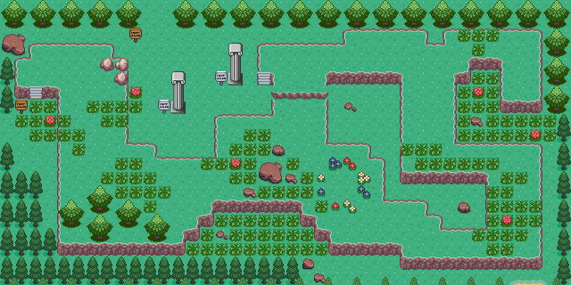

# Route 2

## Connections
### [Cotton Town](cotton-town.md)
### [City Park](city-park.md)
### [Brideswood](brideswood.md)

## Events
### Event 1
(When you first step onto Route 2)

[Rival Billie](../npcs/rival-billie.md):
- Hey cheapskate! Still got your stolen tuxemon?
- STARTER level 6, [Eyenemy](/monsters/eyenemy.md) level 6, [Cardiling](/monsters/cardiling.md) level 3
- This was a fluke. Our tuxemon were expensive, and that means that they're high quality.

## Locations
Sign a:
- Welcome to Route 2: The historic path.

Sign b: 
- City Park: A taste of the wild.

Signs c:
- A rare ancient column. This was once part of a temple building.
- A rare ancient column. Other ruins from the same culture can be found in Route 3.  

## Encounters
- [Cardiling](/monsters/cardiling.md)
- [Aardorn](/monsters/aardorn.md)
- [Cataspike](/monsters/cataspike.md)
- [Eyenemy](/monsters/eyenemy.md) (first appearance)
- [Axolightl](/monsters/axolightl.md) (first appearance)

## Characters
### Trainers
A. **Tennis Player** Roddick
- "When I was ambushed on the dunny by SPIGHTER I was pretty creeped out."
- [Spighter](/monsters/spighter.md) level 8
- "Hey, you didn't seem creeped out at all!"

B. **Picnicker** Marion
- So many tasty ants around! ... For my Aardorn, I mean.
- [Aardorn](/monsters/aardorn.md) level 7, [Aardorn](/monsters/aardorn.md) level 7
- I don't eat ants.

C. **Tennis Player** Graf
- I'm an ace - in battling and tennis!
- [Cardiling](/monsters/cardiling.md) level 7, [Cataspike](/monsters/cataspike.md) level 5, [Cataspike](/monsters/cataspike.md) level 5
- I got served.
