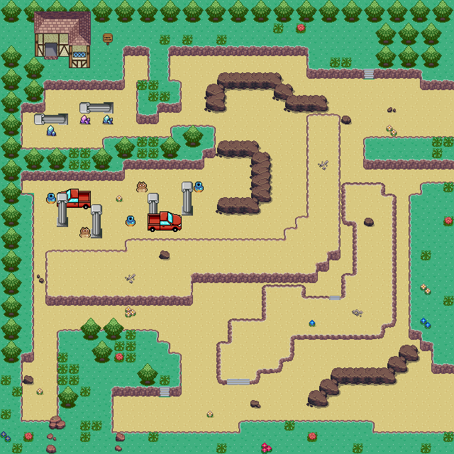

# Route 3

Slogan: Enjoy the scenic beauty of this "artificial canyon".

## Connections
### [Leather Town](leather-town.md)
### [Wayfarer Inn](wayfarer-inn.md)

The stairs to the Wayfarer Inn are blocked by a boulder.

### [Route 4](route-4.md)

## Events

### Event 1
When you pass by on the cliffs overhead, the scene plays out below:

**Spyder Agent** appears from one direction, **Shaft Boss** from the other. 

**Spyder Agent**
- What happened to the excavation?

**Shaft Boss**
- We got ... interrupted. By ... a kid. 

**Spyder Agent**
- A kid?!

**Shaft Boss**
- But we did manage to recover one ... 

**Spyder Agent**
- Hush! You know that's top secret. Alright, hand it over and scram!

**Shaft Boss**
- Okay, here ... uh!

An egg appears between them. It shakes, cracks, and then a dark flying thing escapes and flies north.

**Spyder Agent**
- What the?! Come with me, you can explain this to HQ!

**Spyder Agent** and **Shaft Boss** leave.

### Event 2
When you defeat the **Shaft Boss**, she drops the [Sledgehammer](/items/sledgehammer.md). You can then break the boulder blocking the way.

## Encounters
### Grass
- [Elofly](/monsters/elofly.md) (first appearance)
- [Shybulb](/monsters/shybulb.md) (first appearance)
- [Cardiling](/monsters/cardiling.md)
- [Squabbit](/monsters/squabbit.md)

### Sand
- [Pawsand](/monsters/pawsand.md) (first appearance)
- [Seirein](/monsters/seirein.md) (first appearance)
- [Tumblequill](/monsters/tumblequill.md) (first appearance)
- [Baoby](/monsters/baoby.md) (first appearance, night)
- [Imbrickcile](/monsters/imbrickcile.md) (first appearance, night)
- [Selket](/monsters/selket.md) (first appearance, night)

## Characters
### Trainers
A. **Miner** Roxby
- Bring that pile driver over here and be quick! Hey ... you don't look like a miner. 
- [Rockitten](/monsters/rockitten.md) level 13, [Ignibus](/monsters/ignibus.md) level 13
- Scram!
- I hope Boss is not mad - she gets angry so fast... But she is a nice person and has a heart like a diamond.

B. **Miner** Surat
- They call it the "dark artery" - the fossilized blood and bone of ancient tuxemon beneath the soil. And we get to dig it up!
- [Selket](/monsters/selket.md) level 12, [Grintot](/monsters/grintot.md) level 12
- I knew you wouldn't understand. 

C. **Miner** Twig
- Some of the stuff we're digging up belongs in a museum! Wait, you don't work here. 
- [Aardorn](/monsters/aardorn.md) level 11, [Tumblequill](/monsters/tumblequill.md) level 11
- Don't mention that museum stuff to the boss, okay?
- I will train more and become as strong as our Boss. She worked so hard to become the leader, I wanna be like her someday.

D. [Shaft Boss](../npcs/zoolander.md) Zoolander
-  A boulder is causing problems for travelers? It's "our fault"? Who cares? We've got urgent work to do!
- [Eruptibus](/monsters/eruptibus.md) (level 14), [Selket](/monsters/selket.md) (level 14), [Grinflare](/monsters/grinflare.md) level 16, [B-ver.1](/monsters/b-ver.1.md) level 16
- Ah, I dropped my sledgehammer!
- Now, where did I put that sledgehammer? I'll need it if I'm to break through that boulder between here and the Inn.

E. **Fisher** Wanda
- All I ever seem to catch is boring **Nudiflot**!
- [Nudiflot F](/monsters/nudiflot-f.md) level 8, [Nudiflot F](/monsters/nudiflot-f.md) level 8, [Nudiflot F](/monsters/nudiflot-f.md) level 8, [Nudiflot M](/monsters/nudiflot-m.md) level 8, [Nudiflot M](/monsters/nudiflot-m.md) level 8, [Nudiflot M](/monsters/nudiflot-m.md) level 8
- The fishing's good in [Flower City](flower-city.md) - but who wants to walk that far? ''(Protagonist gains [Fishing Rod](/items/fishing-rod.md))''

F. **Tennis Player** Connor
- "My Weavifly is fighting fit now - there was a while there where it couldn't fly."
- [Weavifly](/monsters/weavifly.md) level 12, [Cataspike](/monsters/cataspike.md) level 8, [Cataspike](/monsters/cataspike.md) level 8, [Cataspike](/monsters/cataspike.md) level 8, [Cataspike](/monsters/cataspike.md) level 8, [Cataspike](/monsters/cataspike.md) level 8
- Oh well, this will be a learning experience for them.

G. **Scientist** Curie
- Look at my magnificent invention!
- [Propellercat](/monsters/propellercat.md) level 13
- Why did you do that?

H. **Tennis Player** Novak
- My Elofly is a genius! I'm going to collect as many as I can.
- [Elofly](/monsters/elofly.md) level 13
- Hmm, not smart enough ...

I. **Enforcer** Weaver
- Hey, butt out of it! This mine site belongs to Shaft!
- [Pythwire](/monsters/pythwire.md) level 12, [Squabbit](/monsters/squabbit.md) level 12
- Go on, get out!

J. **Spyder Agent** ??? (only appears on your first time exiting the [Wayfarer Inn](wayfarer-inn.md))
- Ah, the Enforcers weren't meant to let anyone out!
- [Cardiwing](/monsters/cardiwing.md) level 16
- I'll reveal nothing about our plot! In fact, forget I said anything about a plot!
