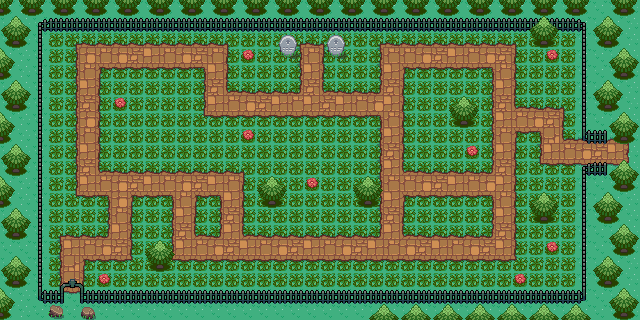

# Route 5

## Connections
### [Flower City](flower-city.md)
### [Timber Town](timber-town.md)

## Events
### Event 1
''When you first enter Route 5 through the BROKEN-INTO HOUSE,'' you are intercepted by a **Spyder Rookie**, who battles you. She lets slip that she has some knowledge of your character that only an ENFORCER would have.

## Encounters 
- [Foofle](/monsters/foofle.md) (first appearance)
- [Vamporm](/monsters/vamporm.md)
- [Dracune](/monsters/dracune.md)
- [Anoleaf](/monsters/anoleaf.md)
- [Gectile](/monsters/gectile.md)

## Trainers
The trainers are arrayed so that people avoiding grass encounters by walking on the path have to provoke the trainers.

A. **Picnicker** Sara
- My Capiti looks cute and all, but I can't wait until it grows into an adult!
- [Capiti](/monsters/capiti.md) level 20
- Oh well, not today!

B. **Soldier** Hunter
- It takes a lot to hold a team together.
- [Elowind](/monsters/elowind.md) level 18, [Elofly](/monsters/elofly.md) level 16, [Elofly](/monsters/elofly.md) level 16
- We'll be back.

C. **Picnicker** Edith
- Woohoo! Our millionth ant! ... Uhm, I didn't think anyone would hear that.
- [Aardart](/monsters/aardart.md) level 20
- Let's see if you're so cocky after Aardart eats her two-millionth ant!

''(A family of four are together in a clump)''

D and E. **Little Pair** 2 vs 2: **Cat Girl** Cleo and **Snugglepot** Patra
- Mother says you can trace our bloodline back to the kings who once ruled this country.
- [Memnomnom](/monsters/memnomnom.md) level 20, [Pantherafira](/monsters/pantherafira.md) level 18
- Oh ancestors, we've failed you!

F and G. **Dynamic Dynasts** 2 vs 2: **Homemaker** Tryphaena and **Cool Dude** Marc
- You know, we're descended from ... You've already heard it? Oh.
- [Miaownolith](/monsters/miaownolith.md) level 24, [Criniotherme](/monsters/criniotherme.md) level 22
- Well, might makes right.
