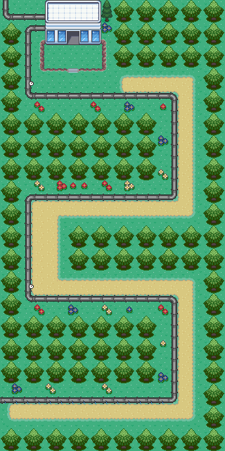

# Side Route B

## Connections
### [Side Route E](side-route-e.md)
### [Datacenter](datacenter.md)

## Events
### An old "Friend"
[Rival Billie](../npcs/rival-billie.md)
- So you noticed the computer system is down too? Fancy a battle to pass the time? ... I guess there are more important things.

## Locations
Sign Datacenter:
- Welcome to the GoodChat data center. An Omnichannel subsidiary.

Sign Route B:
- The winding path to instantaneous communication.

## Characters
### Trainers
**Enforcer Agent** Electra:
- I'm much stronger. 
- [Dracune](/monsters/dracune.md) level 35, [Pantherafira](/monsters/pantherafira.md) level 45, [Tumbleworm](/monsters/tumbleworm.md) level 40
- Twice the pride, double the fall.

**Enforcer Rookie** Cytherea:
- It's a glitch. A bug. A snafu. It's practically a feature. 
- [Fluttaflap](/monsters/fluttaflap.md) level 35, [Criniotherme](/monsters/criniotherme.md) level 35, [Tumblebee](/monsters/tumblebee.md) level 40, 
- At least we developed the technology before anyone else. 

**Enforcer Rookie** Sedna:
- Get out of here! 
- [Squabbit](/monsters/squabbit.md) level 40
- I mean it, you've got to get out of here! 

**Enforcer Agent** Nephthys:
- Nothing to see here. Scram! 
- [Conifrost](/monsters/conifrost.md) level 45, [Djinnbo](/monsters/djinnbo.md) level 45
- We've lost control. Please, you might just be powerful enough to help! 

**Enforcer Boss** Calypso:
- Why you?
- [Ruption](/monsters/ruption.md) level 40, [Puparmor](/monsters/puparmor.md) level 35, [Sumchon](/monsters/sumchon.md) level 40
- I admire you.
