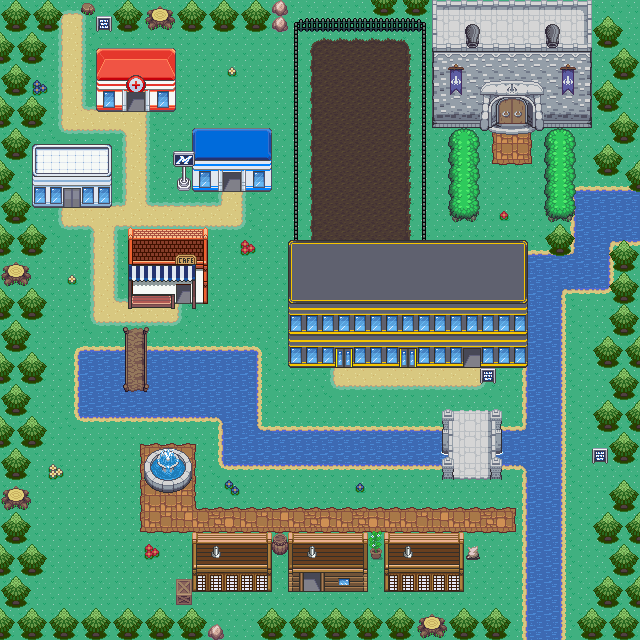

# Timber Town

## Connections
### [Route 5](route-5.md)
### [Tunnel B](tunnel-b.md)
### [Walled Garden](walled-garden.md)

## Events
''When you arrive,'' 

**Riverboat Captain**:
- Ahoy! The Riverboat is re-opening. Free travel for all children. We can take you anywhere between here and Paper Town. Other stations further downriver will be opening over the current days. ... What's that, you're from Paper Town? Maybe you should visit your family! I hear a new Daycare Center has started up there. 

(As you visit each additional town, its RIVERBOAT STATION opens). He also tells you that the DAYCARE CENTER in PAPER TOWN has reopened. (As the game expands, this can also be used to access to other maps unrelated to the main plot.)

## Locations
### Cafe

**Magician**
- Hey, that's a nice phone you've got there ... Your mum made it for you? Heaps cool! Then you've gotta install my newest social media app. It's called [Contacts App](/items/contacts-app.md). It keeps track of all the people you meet and tells you what they're up to.

**Florist**
- I overheard something interesting today, would you like to know? (Y/N)
if yes:
- [Flashback](../flashbacks/petals-of-progress.md)
if no
- No worries, it's not that important. Just some gossip about two florists.
then:
- I'm glad I could share that with you. It's always interesting to see how people react to change.

### House
**Firefighter**
- Hey, do you treat your tuxemon with proper respect?! 
- Sorry, I can be very blunt. But you wouldn't believe the damage that tuxemon can do if they aren't taken proper care of.
- Last week a Tikoal almost burnt down its owner's house! 
- Hey, do you want a Tikoal? I could really do with a Chillimp, if you've got one.
(trade [Chillimp](/monsters/chillimp.md) for [Tikoal](/monsters/tikoal.md))

### [Scoop HQ](scoop-hq.md)
Outside, an event just before the Protagonist can enter.

[Dante](../npcs/dante.md) walks up.
- Hey, NAME. Are you planning to break into these HQ?
- Make sure you're well prepared before you do, because it's difficult to get out once you're inside!
- You'll need to call your mom to let her know you're safe. Use this app!

### Scoop Store
Stock:
- [Repellent](/items/repellent.md) — $100
- [Super Potion](/items/super-potion.md) — $300
- [Lavish Tuxeball](/items/lavish-tuxeball.md) — $300
- [Restoration](/items/restoration.md) — $400
- [Boost Armor](/items/boost-armor.md) — $550
- [Boost Dodge](/items/boost-dodge.md) — $550
- [Boost Melee](/items/boost-melee.md) — $550
- [Boost Ranged](/items/boost-ranged.md) — $550
- [Boost Speed](/items/boost-speed.md) — $550
- [Majestic Tuxeball](/items/majestic-tuxeball.md) — $600
- [Escape Key](/items/escape-key.md) — $600
- [Revive](/items/revive.md) — $1,000
- [Cureall](/items/cureall.md) — $1,500
- [Raise HP](/items/raise-hp.md) — $10,000
- [Raise Armor](/items/raise-armor.md) — $10,000
- [Raise Dodge](/items/raise-dodge.md) — $10,000
- [Raise Melee](/items/raise-melee.md) — $10,000
- [Raise Ranged](/items/raise-ranged.md) — $10,000
- [Raise Speed](/items/raise-speed.md) — $10,000

Tech counter:
- [Sweet Sand](/items/sweet-sand.md) — $2,000
- [Sea Girdle](/items/sea-girdle.md) — $2,000
- [Dollfin](/monsters/dollfin.md) — $4,000 (level 10)

### [Walled Garden](walled-garden.md)
Outside, if the player has not yet defeated Midas in the [Walled Garden](walled-garden.md):

**Rogue**
- Welcome to the Walled Garden. **Gold Pass**, please.
- Oh, I see. This is an exclusive venue for elite battlers. No amateurs.

If the player has a **Gold Pass**:
- Please, come in. Let me take your coat. 

Outside, if the player has defeated Midas:

**Picnicker** Midas:
- Welcome one and all to the Public Garden. Lovers of tuxemon and the sport of tuxemon battling are our honored guests. 

**Rogue**
- Yeah, yeah, let a thousand cheap flowers bloom. In you go.

## Encounters
### Fishing/Surfing
- [Rhinocarpe](/monsters/rhinocarpe.md)
- [Urcheedle](/monsters/urcheedle.md)
- [Drashimi](/monsters/drashimi.md)
